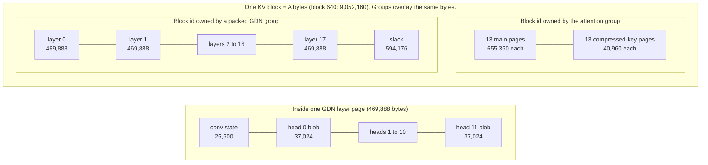

# LeapQuant page packing: fewer GDN groups per request (draft, default off)

Status: draft. The flag is off by default. The numbers below come from the
real KV-cache planner on a CPU or from a byte computation shown here. A GPU run
of 2026-11-15 ([validation note](leapquant-pr170-gpu-validation-2026-11-15.md))
passed the four packed-page kernel tests. No packed engine boot has run yet.
The section "Pending GPU validation" lists what is not proven.

This is the second LeapQuant change for the RDNA2 fork. The first change
(PR #168, [LeapQuant GDN](leapquant-gdn-2026-11-13.md)) stores one GDN value
head in a 37,024-byte blob and leaves "pack two LeapQuant layers into one page"
for this change.

## Credits

- **Algorithm:** LeapQuant, Yi Pan, Haocheng Xi, Kan Zhu, Xingyang Li, Yibo Wu,
  Mayank Mishra, Hongtao Zhang, William X. Zheng, Baris Kasikci, Song Han,
  Kurt Keutzer, Rishabh Iyer and Ion Stoica
  ([arXiv 2609.38166](https://arxiv.org/abs/2609.38166)). This note packs the
  state blob that the paper defines.
- **Record ring, cursor and per-window flush:** the ReplaySSM design by Dao AI Lab
  and NVIDIA ([blog](https://dao-lab.ai/blog/2026/replayssm/),
  [vllm#48018](https://github.com/vllm-project/vllm/pull/48018),
  [vllm#62004](https://github.com/vllm-project/vllm/pull/62004) by Johnny-Liou).
  The blob this note packs holds that ring.
- **Proposal and design context:** the LeapQuant RFC
  [vllm#64725](https://github.com/vllm-project/vllm/issues/64725) by
  lihaoyang-amd. The RFC has no source code, and none of it is used here.
- **Code:** the planner change, the platform change, the tests and this note are
  original work for this fork. No code is taken from outside this fork.
  `kv_cache_planning.py` and `interface.py` keep their upstream authors in git
  history.

## Summary

- The flag is `VLLM_RDNA_GDN_LEAPQUANT_PACK=1`. It needs
  `--replayssm-state-dtype leapquant` (`REPLAYSSM_STATE_DTYPE=leapquant` in the
  launcher), the single switch of the LeapQuant state format. It is off by
  default. With the flag off, the KV cache plan is byte-identical to the base
  branch. (The environment variable `VLLM_RDNA_GDN_LEAPQUANT` that an earlier
  draft of this note named was removed by the config-guards change; see
  `leapquant-config-guards-2026-11-14.md`.)
- "Two layers per page" does not match how this allocator counts memory. A page
  is one layer's slice of a block. Layers of a group already sit side by side in
  one block. The unit of capacity is the KV-cache group, because every group
  takes block ids from one shared pool.
- Two things stop LeapQuant from using fewer groups today. The platform pads
  every GDN page to the attention page. The planner then splits the 36 GDN
  layers into 3 groups of 12. This change removes both.
- With the flag, the planner builds the fewest GDN groups that fit one block.
- **At the shipped 512-token recipe the flag changes nothing.** 36 layers of
  469,888 bytes need 16,915,968 bytes. Two blocks of 512 tokens hold 14,483,456
  bytes. Three groups stay.
- At 608 tokens or more, 36 GDN layers fit two groups of 18. One 262,144-token
  request then holds 10 GDN block ids instead of 15.
- The gain is small. At 608 and 640 tokens, the reported capacity stays within
  0.15 % of the first change at 512 tokens (273,846 and 273,220 against 273,456).
  Short contexts gain more (1k: +7.6 % and +2.0 %).
- Most of the fixed cost of a request is not in the GDN groups. It is in the PLE
  group and the key-ring group. They hold 6 block ids for 1.15 MB of state.
  Merging the PLE layer into a GDN group is the larger lever. It is not in this
  change. A what-if from the real planner follows in the results.

## How this allocator spends memory

The KV cache layout of this fork is block-outermost (`BLNHC`). One block has a
fixed number of bytes, `A`. The pool has `num_blocks = floor(budget / A)` block
ids.

- A KV-cache group owns a list of layers. In one block, its layers sit side by
  side, one page each.
- All groups overlay the same bytes of a block. A block id belongs to one group
  at a time.
- `A` is the largest sum of page sizes over the groups. The attention group
  sets it.
- A request takes `cdiv(max_memory_usage_bytes, page_size)` block ids from each
  group. The log reports `num_blocks` divided by the sum over groups, times
  `max_model_len`.

So the capacity depends on `A` and on the number of block ids per request. It
does not depend on how full the GDN group is. A smaller GDN page frees nothing
until it lets the planner use fewer groups.

Two facts follow.

1. **Padding blocks the gain.** The platform pads a GDN page to one attention
   page (`block x 1,024` bytes). One block holds `A / (block x 1,024) = 13.8`
   such pages. So a padded plan needs `cdiv(36, 13) = 3` groups at every block
   size. That limit is why the first change gains only +2.44 % (266,945 to
   273,456 tokens). The gain comes from the smaller block. The smaller state
   makes that block possible, but the bytes it frees inside each page stay
   unused.
2. **Unpadded pages alone free nothing.** The planner sizes each bucket by the
   repeat count of the attention bucket. That count is 13 (12 QSA layers and
   the MTP draft layer). It makes `cdiv(36, 13) = 3` groups of 12 GDN layers,
   whatever the page size. `test_unpadded_pages_alone_free_no_capacity` shows
   it.

## Byte math

All figures are per TP rank (TP4). Model: Qwen3.8-Flash-Next, 36 GDN layers, 12
QSA layers plus the MTP draft layer, one PLE short-conv layer.

| item | bytes | how |
|---|---:|---|
| LeapQuant blob, one head | 37,024 | layout of PR #168 (window 32, rank 4, MTP2) |
| conv state of one GDN layer | 25,600 | 2,560 channels x 5 taps x 2 bytes |
| LeapQuant GDN page, 12 heads | 469,888 | 25,600 + 12 x 37,024 (458.875 KiB) |
| FP32 GDN page (flag off) | 812,032 | 25,600 + 12 x 65,536 |
| PLE page | 225,280 | 10,240 x 11 x 2 |
| QSA main page, per token | 1,024 | K and V, 256 wide, FP16 |
| compressed-key page, per token | 64 | 128 wide, FP16, 4 tokens per row |
| attention group, per token | 14,144 | 13 layers x (1,024 + 64) |

Alignment: 469,888 = 16 x 29,368, 25,600 = 16 x 1,600, 37,024 = 16 x 2,314 and
`14,144 = 16 x 884`. Every block stride `A = 14,144 x block` is a multiple of 16.

The block size sets how many GDN layers fit one block.

| block | `A` (bytes) | layers per block | groups for 36 | slack of 2 x 18 (bytes) |
|---:|---:|---:|---:|---:|
| 512 | 7,241,728 | 15 | 3 | does not fit |
| 576 | 8,146,944 | 17 | 3 | does not fit |
| 608 | 8,599,552 | 18 | 2 | 141,568 |
| 640 | 9,052,160 | 19 | 2 | 594,176 |
| 1024 | 14,483,456 | 30 | 2 | 6,025,472 |

- Two groups of 18 need `18 x 469,888 = 8,457,984` bytes. That is
  `block >= 598`. The attention kernel needs a multiple of 16. The first block
  size is 608. The first multiple of 64 is 640.
- One group of 36 would need 16,915,968 bytes, so `block >= 1,196`.

Worked example, block 640, packed. `kv_cache_memory_bytes` is 4,026,531,840.

1. `num_blocks = floor(4,026,531,840 / 9,052,160) = 444`.
2. One request of 262,144 tokens takes `cdiv(262,144, 640) = 410` attention
   block ids, 2 GDN groups x 5 state block ids, 5 PLE block ids and 1 ring
   block id. The total is 426.
3. Concurrency is `444 / 426 = 1.0423`. Capacity is
   `int(1.0423 x 262,144) = 273,220` tokens.

The 5 state block ids per Mamba group are `1 + max_concurrent_batches (2) +
num_speculative_blocks (2) + prefill checkpoints (0)`. The first change set
this rule. This change does not touch it.

## Design

### Chosen: fit GDN layers into a block by bytes

The change has three parts. All three are behind the flag.

1. `leapquant_gdn_pack_enabled(cache_config)` reads the flag. It raises if
   `CacheConfig.replayssm_state_dtype` is not `leapquant`. The planner reads
   `leapquant_gdn_pack_requested()` and packs only the Mamba buckets whose
   `MambaSpec.state_format` is the LeapQuant identity, so a bucket of another
   format keeps the old split.
2. `Platform._align_hybrid_block_size` stops after it sets the block size. It
   does not set `mamba_page_size_padded`. GDN and PLE pages keep their natural
   size.
3. `_get_packed_kv_cache_groups` uses `cdiv(layers, layers_per_block)` groups
   for a Mamba bucket. Without the flag it uses the larger of that value and
   the repeat-pattern count.

The worker needs no change. `allocate_kv_cache` already builds one view per
layer from `layer_stride` and `block_stride`. `MambaBase.bind_kv_cache` slices
the conv state and the blob from that view. `_LqNormalizeGroup` takes the layer
offsets from `data_ptr` differences. The kernels take 64-bit offsets and check
the 16-byte alignment of the blob pointer and its two strides. The kernel
facts come from reading the source. No kernel ran.



Layer `k` of a group starts at `k x 469,888` bytes in the block. Its conv state
is the first 25,600 bytes. Head `h` of its blob starts at
`k x 469,888 + 25,600 + h x 37,024`. The block stride is `A`.
`test_packed_views_are_aligned_disjoint_and_inside_one_block` checks this with
the real `allocate_kv_cache` and `bind_kv_cache` on a CPU: every range is inside
the block, no two ranges share a byte, and every start is 16-byte aligned.

### Rejected options

| option | why not |
|---|---|
| A. A "virtual layer" spec that holds two LeapQuant pages | Same group count as the chosen option (18 virtual layers, 2 groups, same `block >= 598`). It adds a spec type, two layer names bound to one tensor, and a new normalize grouping. More code for the same result. |
| B. Larger block size alone | The repeat-pattern split still makes 3 groups. `test_unpadded_pages_alone_free_no_capacity` shows it. |
| C. Keep the padding and change only the planner | One block holds at most 13 padded pages, so 3 groups remain. |
| D. Merge the PLE layer into a GDN group | The larger lever (see below). It needs `MambaSpec.is_uniform_with_collection` to accept two page sizes and `tp_replicated` values, and a bytes-aware split in the planner. It is a separate change. |
| E. A smaller blob so 36 layers fit 2 blocks at 512 tokens | Needs a page of at most 402,304 bytes. The window is a module constant (32). `LeapQuantLayout` gives 395,584 bytes for window 20 (30,832 per head), 370,816 for window 16 (28,768 per head) and 420,352 for window 24 (too large). The first change serves window 32. This note does not evaluate smaller windows. |

### Where the fixed bytes of a request go

One request of 262,144 tokens holds block ids outside the attention group. The
table is from the real planner (`Plan.fixed_cost`). "Used" is the state the
blocks carry. The key-ring page is modeled as 2,048 bytes per layer. The
boot-log capacity does not depend on that value.

| Block | Mode | Owner | Block ids | Bytes held | Bytes used | Used |
|---|---|---|---:|---:|---:|---:|
| 512 | LeapQuant padded (PR 1) | GDN | 15 | 108,625,920 | 84,579,840 | 77.9% |
| 512 | LeapQuant padded (PR 1) | PLE | 5 | 36,208,640 | 1,126,400 | 3.1% |
| 512 | LeapQuant padded (PR 1) | ring | 1 | 7,241,728 | 26,624 | 0.4% |
| 512 | LeapQuant padded (PR 1) | total | 21 | 152,076,288 | 85,732,864 | 56.4% |
| 640 | LeapQuant packed | GDN | 10 | 90,521,600 | 84,579,840 | 93.4% |
| 640 | LeapQuant packed | PLE | 5 | 45,260,800 | 1,126,400 | 2.5% |
| 640 | LeapQuant packed | ring | 1 | 9,052,160 | 26,624 | 0.3% |
| 640 | LeapQuant packed | total | 16 | 144,834,560 | 85,732,864 | 59.2% |

Packing fills the GDN blocks (77.9 % to 93.4 %). The PLE group holds 5 block ids
for 225,280 bytes of state each time. The ring holds 1 block id for 26,624
bytes. Those two owners take 6 of the 16 block ids.

## Use

```bash
bash tools/rdna/serve_rdna.sh RECIPE=flashnext-leapquant-mtp2 \
    VLLM_RDNA_GDN_LEAPQUANT_PACK=1 BLOCK_SIZE=640
```

- At `BLOCK_SIZE=512` the plan keeps 3 GDN groups and the same capacity. The
  planner says so in the boot log (captured from the CPU planner):
  `LeapQuant page packing: 36 Mamba layer(s) of 469888 bytes use 3 KV-cache
  group(s); one block holds 15 of them.` At block 640 the same line ends with
  `use 2 KV-cache group(s); one block holds 19 of them.` The one-layer PLE
  bucket has no LeapQuant state format, so the planner does not log it.
- Set `MAXBAT` to a multiple of the block size (2,560 for block 640). A prefill
  chunk ends on a state block boundary, so 2,048 tokens schedule 1,920 per step
  at block 640 [INFERENCE, not measured].
- The flag raises at start-up if `--replayssm-state-dtype leapquant` is not set.
  That flag itself is refused when the GPU is not gfx10x.
- No recipe sets the flag. No recipe changed.

## Results (CPU, real planner)

The tables come from `python tests/v1/core/test_leapquant_page_packing.py`.
The builder uses the Flash-Next geometry per rank (see the test header). With
the flag off it reproduces two real boot logs: block 512 LeapQuant gives 556
blocks and 273,456 tokens, and block 1024 FP32 gives 278 blocks and 266,945
tokens. `kv_cache_memory_bytes` is 4,026,531,840, `max_model_len` is 262,144,
MTP2, 8 sequences, async scheduling.

Column notes: "Blocks" is `num_blocks`. "1k", "4k" and "32k" are the tokens the
log would print with `--max-model-len` set to that length. "8 requests" is the
longest `max_model_len` at which the planner still reports a concurrency of 8.
"Blocks per request" is non-attention block ids / attention block ids.

| Block | Mode | GDN groups | Blocks per request | Blocks | Tokens at 262,144 | Concurrency | 1k | 4k | 32k | 8 requests |
|---|---|---|---|---|---|---|---|---|---|---|
| 1024 | FP32 (flag off) | 3 x 12 | 17 / 256 | 278 | 266,945 | 1.0183 | 15,815 | 54,223 | 185,908 | 17,408 |
| 512 | LeapQuant padded (PR 1) | 3 x 12 | 21 / 512 | 556 | 273,456 | 1.0432 | 24,754 | 78,530 | 214,341 | 24,576 |
| 512 | LeapQuant packed | 3 x 12 | 21 / 512 | 556 | 273,456 | 1.0432 | 24,754 | 78,530 | 214,341 | 24,576 |
| 608 | LeapQuant padded (PR 1) | 3 x 12 | 21 / 432 | 468 | 270,824 | 1.0331 | 20,836 | 68,461 | 204,472 | 22,496 |
| 608 | LeapQuant packed | 2 x 18 | 16 / 432 | 468 | 273,846 | 1.0446 | 26,624 | 83,344 | 219,077 | 25,536 |
| 640 | LeapQuant padded (PR 1) | 3 x 12 | 21 / 410 | 444 | 270,050 | 1.0302 | 19,767 | 64,950 | 199,301 | 21,760 |
| 640 | LeapQuant packed | 2 x 18 | 16 / 410 | 444 | 273,220 | 1.0423 | 25,258 | 79,070 | 213,955 | 24,960 |
| 1024 | LeapQuant padded (PR 1) | 3 x 12 | 21 / 256 | 278 | 263,090 | 1.0036 | 12,939 | 45,547 | 171,877 | 13,312 |
| 1024 | LeapQuant packed | 2 x 18 | 16 / 256 | 278 | 267,926 | 1.0221 | 16,745 | 56,934 | 189,781 | 18,432 |
| 512 | what-if: PLE in a GDN group (not built) | 3 x 13+ | 16 / 512 | 556 | 276,045 | 1.0530 | 31,630 | 94,890 | 227,737 | 27,136 |
| 640 | what-if: PLE in a GDN group (not built) | 2 x 19+ | 11 / 410 | 444 | 276,465 | 1.0546 | 34,973 | 101,034 | 230,936 | 28,160 |

Changes against the first change (padded, block 512), computed from the table:

| Row | Tokens at 262,144 | 1k | 4k | 32k | 8 requests |
|---|---:|---:|---:|---:|---:|
| 608 packed | +0.14 % | +7.55 % | +6.13 % | +2.21 % | +3.91 % |
| 640 packed | -0.09 % | +2.04 % | +0.69 % | -0.18 % | +1.56 % |
| 1024 packed | -2.02 % | -32.35 % | -27.50 % | -11.46 % | -25.00 % |
| 512, PLE in a GDN group (what-if) | +0.95 % | +27.78 % | +20.83 % | +6.25 % | +10.42 % |
| 640, PLE in a GDN group (what-if) | +1.10 % | +41.28 % | +28.66 % | +7.74 % | +14.58 % |

Changes against the same block size, padded: packing adds +1.12 % (608),
+1.17 % (640) and +1.84 % (1024) tokens at 262,144, and +27.8 % to +29.4 % at 1k.
At block 1024, packed LeapQuant reaches 267,926 tokens against 266,945 for FP32
(+0.37 %), and 18,432 against 17,408 at 8 requests (+5.9 %).

What the table shows:

- The flag is a no-op at 512. The two rows are equal.
- Packing recovers the loss that a bigger block causes. It does not beat the
  first change at maximum context by more than 0.14 %.
- The attention group is about 96 % of the bytes of a max-context request, so
  the GDN groups can move that number by a few percent at most.
- Short contexts and many concurrent requests gain more, because the fixed
  cost per request is a larger share there.
- The PLE what-if is the larger lever. It moves 1k by +28 % to +41 % and the
  8-request limit by +10 % to +15 %. It stays outside this change (option D).

The what-if sets the PLE page equal to the GDN page and lets the planner merge
it into the GDN bucket. It is a planner experiment, not a layout that serves.

## Tests

`tests/v1/core/test_leapquant_page_packing.py` has 31 CPU tests. They need no
GPU and no network. The model is a stub config, and the planner is the real
one.

| test group | what it proves |
|---|---|
| page sizes and guard | The natural page sizes (469,888, 812,032 and 225,280 bytes). The flag raises when `--replayssm-state-dtype leapquant` is not set (config level and on the platform path). |
| flag-off identity | The flag-off plan reproduces the real boot logs. It is identical to the base branch for three layouts (goldens recorded from `7b4aff7fe3`). |
| group count | 512 and 576 keep 3 groups. 608, 640 and 1024 give 2 groups of 18. The planner logs the split (`LeapQuant page packing: ...`) with the flag on and logs nothing with it off. |
| capacity | Packed plans allocate 10 GDN block ids per request instead of 15, and the pinned token counts of the table hold. |
| speculative slots | Slots, checkpoints and the `align` mode are unchanged under the flag. |
| layout fallback | A layout that is not block-outermost pads the pages again, so the flag has no effect there. |
| LeapQuant buckets only | The same unpadded specs without `state_format` keep 3 groups of 12; with it they pack to 2 groups of 18. |
| capacity log | The concurrency and token math of `get_kv_cache_capacity` and of the `GPU KV cache size` log line. |
| views | Per-layer views are aligned to 16 bytes, disjoint and inside one block. The grouped normalize offsets are `k x 469,888`. |
| fixed cost | The block ids and bytes of the PLE and ring owners. |

Commands:

```bash
pytest tests/v1/core/test_leapquant_page_packing.py -q
python tests/v1/core/test_leapquant_page_packing.py   # prints the tables
```

## Risks

- **No capacity gain at the shipped recipe.** The flag needs a block of 608
  tokens or more. A new block size changes the prefix-cache hash grain, the
  state checkpoint grid and the prefill chunk boundaries. It needs a recipe
  qualification run.
- **Neighbor corruption.** Padding hid out-of-bounds writes. In a packed block,
  the byte after the last head blob of layer `k` is the conv state of layer
  `k + 1`. A kernel that writes past its blob now corrupts the neighbor. Only
  a GPU run can rule this out.
- **Process-wide flag.** The platform and the planner read the same variable in
  different processes. Every process of one serve must see the same value. The
  LeapQuant format itself travels in the config, not in the environment. The
  serve script exports `VLLM_*` recipe variables, and child processes inherit
  them.
- **Other Mamba layers.** With the flag on, the platform keeps every Mamba page
  at its natural size. The byte-fit split applies to the LeapQuant buckets
  only (`state_format`). For Flash-Next that is the GDN bucket; the one-layer
  PLE bucket has no state format and keeps the repeat-pattern split.
- **Other layouts.** A layout that is not block-outermost pads Mamba pages
  again in `unify_kv_cache_spec_page_size`. The result equals the first change.
  A test pins this.
- **Not reviewed.** KV connectors (NIXL), CPU offload and hisparse. Do not
  enable them with the flag until someone reviews them.

## Pending GPU validation

Status after the GPU run of 2026-11-15 on two V620 with the 27B AWQ at TP2
([validation note](leapquant-pr170-gpu-validation-2026-11-15.md)). The kernel
item is done. The 27B packed boot (arm `P`, block 1024) was not run: the chain
that was to boot it was terminated at 18:17 and the lease passed to another job.
The Flash-Next items need four GPUs, so the other items are open.

- [ ] Boot with `REPLAYSSM_STATE_DTYPE=leapquant VLLM_RDNA_GDN_LEAPQUANT_PACK=1` at
  block 640. The log shows 5 KV-cache groups instead of 6 and the line
  `use 2 KV-cache group(s); one block holds 19 of them`. It prints
  `GPU KV cache size: 273,220 tokens` and a concurrency of 1.04x. These are the
  CPU planner values [INFERENCE until booted].
- [x] LeapQuant kernels on packed pages with layers at `k x 469,888` bytes
  inside one block. Check equality with isolated blobs. Check that the bytes
  of the neighbor layers and of the slack stay unchanged. The GPU tests
  `test_packed_pages_match_isolated_blobs` (store, normalize, decode) and
  `test_grouped_normalize_on_packed_pages` (grouped normalize) in
  `tests/kernels/mamba/test_gdn_leapquant_rdna2.py` passed on gfx1030 on
  2026-11-15, two parametrizations each. `mono_gdn_lq_rdna2` and the
  materialize kernel have no packed-page test yet.
- [ ] Grouped normalize with two groups of 18 layers (`_LqNormalizeGroup`
  offsets) under `FULL_AND_PIECEWISE` capture and replay.
- [ ] Align-mode state copies (`v1_mamba_rdna2.cu`) with unpadded 469,888-byte
  pages, MTP2 and prefix caching on.
- [ ] Serving at block 640: MTP2 acceptance, 1k, 4k, 32k at concurrency 8,
  with `MAXBAT` 2,048 and 2,560. Compare with the first change at block 512.
- [ ] Decode quality (KL and the gated checks of the first change). The packing
  does not change the math, so any shift points to a layout bug.
- [ ] Block 608 against block 640. 608 is a multiple of 16 but not of 64.
- [ ] Prefix-cache hit rates and preemption with 2 GDN groups. No KFD eviction
  increments and no fault markers.
- [ ] Boot memory: the free VRAM after boot is the same as at block 512 for the
  same `kv_cache_memory_bytes`.
- [ ] Connectors, offload and hisparse stay unreviewed.

## Open questions

1. Is block 608 or 640 acceptable for the Flash-Next recipe?
2. Should a follow-up merge the PLE layer into a GDN group (option D)? The
   what-if shows +6 % to +41 % from 32k down to 1k contexts, and about +1 % at
   262,144 tokens.
3. Should the key ring stay in its own group? A ring block id costs a whole block
   for 26 KB. A ring cannot join a Mamba group (different manager, block size 8).
